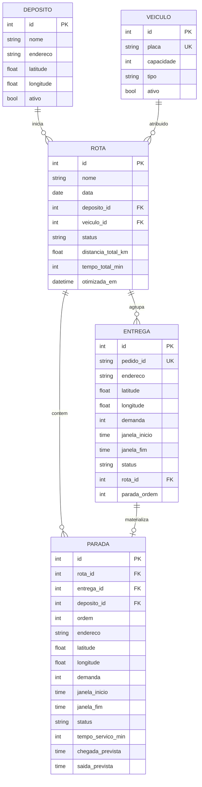

# JAS - Easy Path: Arquitetura do MVP (Issue #8)

Documento permanente de arquitetura do MVP. Define stack, modelo de dados,
serviços externos, fluxo de otimização e contratos de API.

## 1. Technology Stack

### Frontend
- **Framework**: React 19 + TypeScript
- **Build Tool**: Vite 8
- **Styling**: Tailwind CSS v4
- **State Management**: Zustand
- **Routing**: React Router DOM v7
- **Maps**: Leaflet + React Leaflet
- **Charts**: Recharts
- **CSV Parsing**: PapaParse
- **Linting**: Oxlint

### Backend
- **Language**: Python 3.11+
- **Framework**: FastAPI
- **Database**: PostgreSQL via SQLAlchemy 2.0 (async)
- **ORM**: SQLAlchemy with asyncpg driver
- **Validation**: Pydantic v2
- **Optimization**: Google OR-Tools (CVRP solver with temporal constraints)

### Infrastructure
- **Database**: PostgreSQL 15+
- **Geocoding**: OpenStreetMap Nominatim (free, rate-limited)
- **Routing Matrix**: OpenRouteService (free tier) or OSRM (self-hosted)
- **Containerization**: Docker (planned)

---

## 2. Data Models

### 2.1 Core Entities

#### Entrega (Delivery)
```python
class Entrega(Base):
    __tablename__ = "entregas"
    
    id: Mapped[int] = mapped_column(primary_key=True)
    pedido_id: Mapped[str] = mapped_column(String(50), unique=True, index=True)
    endereco: Mapped[str] = mapped_column(Text, nullable=False)
    latitude: Mapped[float] = mapped_column(Float, nullable=False)
    longitude: Mapped[float] = mapped_column(Float, nullable=False)
    demanda: Mapped[int] = mapped_column(Integer, default=1)
    janela_inicio: Mapped[time | None] = mapped_column(Time, nullable=True)
    janela_fim: Mapped[time | None] = mapped_column(Time, nullable=True)
    status: Mapped[EntregaStatus] = mapped_column(
        Enum(EntregaStatus), default=EntregaStatus.PENDENTE
    )
    observacoes: Mapped[str | None] = mapped_column(Text, nullable=True)
    created_at: Mapped[datetime] = mapped_column(DateTime, default=func.now())
    updated_at: Mapped[datetime] = mapped_column(DateTime, default=func.now(), onupdate=func.now())
    rota_id: Mapped[int | None] = mapped_column(ForeignKey("rotas.id"), nullable=True, index=True)
    parada_ordem: Mapped[int | None] = mapped_column(Integer, nullable=True)
```

#### Veículo (Vehicle)
```python
class Veiculo(Base):
    __tablename__ = "veiculos"
    
    id: Mapped[int] = mapped_column(primary_key=True)
    placa: Mapped[str] = mapped_column(String(10), unique=True, index=True)
    capacidade: Mapped[int] = mapped_column(Integer, nullable=False)
    tipo: Mapped[VeiculoTipo] = mapped_column(Enum(VeiculoTipo), default=VeiculoTipo.CAMINHAO)
    ativo: Mapped[bool] = mapped_column(Boolean, default=True)
    created_at: Mapped[datetime] = mapped_column(DateTime, default=func.now())
```

#### Rota (Route)
```python
class Rota(Base):
    __tablename__ = "rotas"
    
    id: Mapped[int] = mapped_column(primary_key=True)
    nome: Mapped[str] = mapped_column(String(100), nullable=False)
    data: Mapped[date] = mapped_column(Date, nullable=False, index=True)
    deposito_id: Mapped[int] = mapped_column(ForeignKey("depositos.id"), nullable=False)
    veiculo_id: Mapped[int | None] = mapped_column(ForeignKey("veiculos.id"), nullable=True)
    status: Mapped[RotaStatus] = mapped_column(Enum(RotaStatus), default=RotaStatus.RASCUNHO)
    distancia_total_km: Mapped[float | None] = mapped_column(Float, nullable=True)
    tempo_total_min: Mapped[int | None] = mapped_column(Integer, nullable=True)
    created_at: Mapped[datetime] = mapped_column(DateTime, default=func.now())
    updated_at: Mapped[datetime] = mapped_column(DateTime, default=func.now(), onupdate=func.now())
    otimizada_em: Mapped[datetime | None] = mapped_column(DateTime, nullable=True)
```

#### Parada (Stop)
```python
class Parada(Base):
    __tablename__ = "paradas"
    
    id: Mapped[int] = mapped_column(primary_key=True)
    rota_id: Mapped[int] = mapped_column(ForeignKey("rotas.id"), nullable=False, index=True)
    entrega_id: Mapped[int | None] = mapped_column(ForeignKey("entregas.id"), nullable=True, index=True)
    deposito_id: Mapped[int | None] = mapped_column(ForeignKey("depositos.id"), nullable=True)
    ordem: Mapped[int] = mapped_column(Integer, nullable=False)
    endereco: Mapped[str] = mapped_column(Text, nullable=False)
    latitude: Mapped[float] = mapped_column(Float, nullable=False)
    longitude: Mapped[float] = mapped_column(Float, nullable=False)
    demanda: Mapped[int] = mapped_column(Integer, default=0)
    janela_inicio: Mapped[time | None] = mapped_column(Time, nullable=True)
    janela_fim: Mapped[time | None] = mapped_column(Time, nullable=True)
    status: Mapped[ParadaStatus] = mapped_column(Enum(ParadaStatus), default=ParadaStatus.PENDENTE)
    tempo_servico_min: Mapped[int] = mapped_column(Integer, default=8)
    chegada_prevista: Mapped[time | None] = mapped_column(Time, nullable=True)
    saida_prevista: Mapped[time | None] = mapped_column(Time, nullable=True)
    observacoes: Mapped[str | None] = mapped_column(Text, nullable=True)
```

#### Depósito (Depot)
```python
class Deposito(Base):
    __tablename__ = "depositos"
    
    id: Mapped[int] = mapped_column(primary_key=True)
    nome: Mapped[str] = mapped_column(String(100), nullable=False)
    endereco: Mapped[str] = mapped_column(Text, nullable=False)
    latitude: Mapped[float] = mapped_column(Float, nullable=False)
    longitude: Mapped[float] = mapped_column(Float, nullable=False)
    ativo: Mapped[bool] = mapped_column(Boolean, default=True)
    created_at: Mapped[datetime] = mapped_column(DateTime, default=func.now())
```

### 2.2 Enums

```python
class EntregaStatus(str, StrEnum):
    PENDENTE = "PENDENTE"
    ATRIBUIDA = "ATRIBUIDA"
    EM_ROTA = "EM_ROTA"
    ENTREGUE = "ENTREGUE"
    FALHA = "FALHA"
    CANCELADA = "CANCELADA"

class VeiculoTipo(str, StrEnum):
    MOTO = "MOTO"
    CARRO = "CARRO"
    CAMINHAO = "CAMINHAO"
    VAN = "VAN"

class RotaStatus(str, StrEnum):
    RASCUNHO = "RASCUNHO"
    OTIMIZADA = "OTIMIZADA"
    EM_ANDAMENTO = "EM_ANDAMENTO"
    CONCLUIDA = "CONCLUIDA"
    CANCELADA = "CANCELADA"

class ParadaStatus(str, StrEnum):
    PENDENTE = "PENDENTE"
    EM_ANDAMENTO = "EM_ANDAMENTO"
    CONCLUIDA = "CONCLUIDA"
    FALHA = "FALHA"
    PULADA = "PULADA"
```

### 2.3 ER Diagram (Mermaid)



---

## 3. Geocoding Service: OpenStreetMap Nominatim

### 3.1 Service Definition
- **Provider**: OpenStreetMap Nominatim (https://nominatim.openstreetmap.org/)
- **Protocol**: HTTPS REST API
- **Rate Limit**: 1 request/second (strict policy)
- **User-Agent**: Required (identify application)
- **Cost**: Free (with attribution)

### 3.2 API Contract

**Forward Geocoding (Address → Coordinates)**
```
GET https://nominatim.openstreetmap.org/search
Params:
  - q: string (address query)
  - format: json
  - limit: 1
  - addressdetails: 1
  - countrycodes: br (optional, restrict to Brazil)
```

**Response:**
```json
[
  {
    "place_id": 123456,
    "licence": "Data © OpenStreetMap contributors",
    "osm_type": "way",
    "osm_id": 789012,
    "lat": "-23.5505",
    "lon": "-46.6333",
    "display_name": "Rua Exemplo, 123 - Centro, São Paulo - SP, 01000-000, Brasil",
    "address": {
      "road": "Rua Exemplo",
      "house_number": "123",
      "neighbourhood": "Centro",
      "city": "São Paulo",
      "state": "São Paulo",
      "postcode": "01000-000",
      "country": "Brasil",
      "country_code": "br"
    },
    "boundingbox": ["-23.5510", "-23.5500", "-46.6340", "-46.6320"]
  }
]
```

**Reverse Geocoding (Coordinates → Address)**
```
GET https://nominatim.openstreetmap.org/reverse
Params:
  - lat: float
  - lon: float
  - format: json
  - addressdetails: 1
```

### 3.3 Limitations & Constraints

| Limitation | Impact | Mitigation |
|------------|--------|------------|
| 1 req/sec rate limit | Slow batch geocoding | Implement queue with delay; cache results |
| No SLA / best effort | Unreliable for production | Fallback to cached/approximate coordinates |
| Ambiguous results | Wrong location selected | Return top 3 options for user confirmation |
| No batch endpoint | N requests for N addresses | Client-side batching with throttling |
| Address format dependency | Brazilian addresses may fail | Normalize address before query (CEP, logradouro, número) |
| No autocomplete built-in | Poor UX for partial input | Use separate autocomplete service (e.g., Pelias) |

### 3.4 Implementation Strategy

```python
class NominatimGeocoder:
    BASE_URL = "https://nominatim.openstreetmap.org"
    
    async def geocode(self, address: str) -> list[GeocodeResult]:
        # 1. Normalize address (CEP, uppercase, abbreviations)
        # 2. Check cache (Redis/in-memory)
        # 3. Request with rate limiting (token bucket)
        # 4. Parse and validate response
        # 5. Return structured results with confidence score
    
    async def reverse_geocode(self, lat: float, lon: float) -> GeocodeResult:
        # Similar flow for reverse lookup
```

---

## 4. Distance/Time Matrix Service: OpenRouteService

### 4.1 Service Definition
- **Provider**: OpenRouteService (https://openrouteservice.org/)
- **Protocol**: HTTPS REST API
- **Free Tier**: 2,000 requests/day, 40 requests/minute
- **Profiles**: driving-car, driving-hgv, cycling-regular, foot-walking
- **Cost**: Free tier available; paid plans for higher volume

### 4.2 API Contract

**Matrix Endpoint**
```
POST https://api.openrouteservice.org/v2/matrix/driving-car
Headers:
  - Authorization: Bearer <API_KEY>
  - Content-Type: application/json
Body:
{
  "locations": [[lon1, lat1], [lon2, lat2], ...],
  "metrics": ["distance", "duration"],
  "units": "m",
  "resolve_locations": true
}
```

**Response:**
```json
{
  "distances": [
    [0, 5200, 8100],
    [5200, 0, 3400],
    [8100, 3400, 0]
  ],
  "durations": [
    [0, 480, 720],
    [480, 0, 240],
    [720, 240, 0]
  ],
  "metadata": {
    "attribution": "openrouteservice.org | OpenStreetMap contributors"
  }
}
```

### 4.3 Alternative: OSRM (Self-hosted)
- **Pros**: No rate limits, free, full control, offline capable
- **Cons**: Requires infrastructure, maintenance, data updates
- **Deployment**: Docker container with Brazil extract (~2GB)
- **API**: Compatible with OpenRouteService matrix format

### 4.4 Limitations & Constraints

| Limitation | Impact | Mitigation |
|------------|--------|------------|
| 40 req/min (free) | Large matrices throttled | Batch locations; cache matrices |
| Max 50 locations/request | Large problems need chunking | Split into sub-matrices; calculate cross-chunk |
| 2,000 req/day | Daily cap for high volume | Monitor usage; upgrade plan if needed |
| Profile limitations | No motorcycle/van specific | Use driving-car as approximation |
| Traffic not real-time | Static travel times | Acceptable for planning; not navigation |

### 4.5 Implementation Strategy

```python
class MatrixService:
    def __init__(self, provider: Literal["ors", "osrm"] = "ors"):
        self.provider = provider
    
    async def get_matrix(
        self,
        locations: list[Location],
        metrics: list[Literal["distance", "duration"]] = ["distance", "duration"]
    ) -> MatrixResult:
        # 1. Validate location count
        # 2. Check cache (keyed by location hashes)
        # 3. If > 50 locations: chunk and calculate cross-chunk
        # 4. Request with retry/backoff
        # 5. Validate symmetric matrix, handle nulls
        # 6. Return structured result with metadata
```

---

## 5. Optimization Flow

### 5.1 End-to-End Flow

```
┌─────────────┐     ┌──────────────┐     ┌─────────────┐     ┌──────────────┐
│   INPUT     │────▶│  GEOCODING   │────▶│   MATRIX    │────▶│  OR-TOOLS    │
│  (Addresses)│     │  (Nominatim) │     │  (ORS/OSRM) │     │  (CVRP+TW)   │
└─────────────┘     └──────────────┘     └─────────────┘     └──────────────┘
                           │                    │                    │
                           ▼                    ▼                    ▼
                    ┌─────────────┐     ┌─────────────┐     ┌──────────────┐
                    │ Coordinates │     │ Distance/   │     │ Routes +     │
                    │ + Validation│     │ Time Matrix │     │ Metrics + ETAs│
                    └─────────────┘     └─────────────┘     └──────────────┘
                                                                       │
                                                                       ▼
                                                              ┌──────────────┐
                                                              │   OUTPUT     │
                                                              │  (Routes,    │
                                                              │   Stops,     │
                                                              │   ETAs, Maps)│
                                                              └──────────────┘
```

### 5.2 Detailed Steps

#### Step 1: Input Validation & Normalization
```python
# Input: List of addresses + depot address + vehicle capacities
# 1. Validate required fields
# 2. Normalize addresses (CEP lookup, format standardization)
# 3. Check for duplicates
# 4. Validate vehicle capacity vs total demand
```

#### Step 2: Geocoding (Parallel with Rate Limiting)
```python
# For each unique address:
# 1. Check cache (address hash → coordinates)
# 2. If cache miss: call Nominatim with exponential backoff
# 3. Validate result quality (confidence, country=BR)
# 4. Handle ambiguous results (multiple matches → flag for review)
# 5. Store in cache
# Output: List[Location] with lat/lon + original address
```

#### Step 3: Matrix Building
```python
# Input: List[Location] (depot + deliveries)
# 1. Build location array [[lon, lat], ...] with depot first
# 2. Request distance + duration matrix from ORS/OSRM (units=m)
# 3. Validate matrix: symmetric, non-negative, handle nulls
# 4. Convert to OR-Tools format (integer meters/seconds)
# 5. Handle failures: fallback to haversine + speed estimate
```

#### Step 4: OR-Tools CVRP Solver with Temporal Constraints
```python
# Input: Matrix, demands, vehicle capacities, depot index, time windows
# 1. Create RoutingIndexManager
# 2. Define distance callback (matrix lookup)
# 3. Add capacity dimension
# 4. Add time dimension with service times (8 min default)
# 5. Set time windows for deliveries and depot (working hours)
# 6. Set search parameters (time limit, first solution strategy)
# 7. Solve
# 8. Extract routes: vehicle → ordered location indices with ETAs
# 9. Calculate metrics per route (distance, time, load)
```

#### Step 5: Result Construction
```python
# 1. Map solver indices back to delivery IDs
# 2. Build Parada objects with sequence, ETA, service time
# 3. Calculate route totals (including return to depot)
# 4. Generate response DTO
# 5. Persist to database (Rota + Paradas)
```

### 5.3 Temporal Constraints

- **Working Hours**: 08:00–18:00 (fixed in the MVP; configurability is out of scope)
- **Service Time**: 8 minutes per stop (fixed `DELIVERY_SERVICE_DURATION_MINUTES` in the engine)
- **Time Windows**: Hard constraints per delivery (janela_inicio/janela_fim)
- **Completion Within Window**: Service must complete before window end
- **Return to Depot**: Must return within working hours

### 5.4 Data Flow Contracts

**Optimization Request (Internal)**
```python
@dataclass
class OptimizationRequest:
    depot: Location
    vehicles: list[Vehicle]
    deliveries: list[Delivery]
    work_start: time = time(8, 0)
    work_end: time = time(18, 0)
    options: OptimizationOptions
    
@dataclass
class OptimizationOptions:
    time_limit_seconds: int = 30
    minimize: Literal["distance", "duration"] = "distance"
    allow_unassigned: bool = False
```

**Optimization Response (Internal)**
```python
@dataclass
class OptimizationResponse:
    routes: list[RouteResult]
    unassigned: list[Delivery]
    status: Literal["optimal", "feasible", "infeasible", "timeout"]
    solve_time_ms: int
    
@dataclass
class RouteResult:
    vehicle_id: int
    stops: list[StopResult]
    total_distance_km: float
    total_duration_min: int
    total_load: int
    
@dataclass
class StopResult:
    delivery_id: int | None
    location: Location
    sequence: int
    arrival_time: time
    departure_time: time
    load_after: int
    is_depot: bool
```

---

## 6. Handling Incomplete/Ambiguous Addresses

### 6.1 Address Classification

| Category | Example | Handling |
|----------|---------|----------|
| **Complete** | "Rua das Flores, 123 - Centro, São Paulo - SP" | Direct geocode |
| **Missing Number** | "Rua das Flores - Centro, São Paulo - SP" | Geocode → return centroid; flag for review |
| **Missing Neighborhood** | "Rua das Flores, 123 - São Paulo - SP" | Geocode (usually works) |
| **Only CEP** | "01000-000" | Geocode CEP → centroid; low confidence |
| **Ambiguous** | "Rua Central" (multiple matches) | Return top 3; require user selection |
| **Invalid** | "Xyzabc 999" | Reject with error; suggest correction |

### 6.2 Validation Pipeline

```python
class AddressValidator:
    def validate(self, address: str) -> ValidationResult:
        # 1. CEP extraction and validation (via ViaCEP or local DB)
        # 2. Component parsing (logradouro, número, bairro, cidade, UF)
        # 3. Format normalization (abbreviations, case)
        # 4. Completeness score (0-100)
        # 5. Return: normalized_address, confidence, issues[]
```

### 6.3 User Interaction Flow

```
User Input
    │
    ▼
┌─────────────────┐
│ Validate &      │
│ Normalize       │
└────────┬────────┘
         │
    ┌────┴────┐
    │ Complete?    │
    └────┬────┘
         │
    ┌────┴────┐
Yes │         │ No
    ▼         ▼
┌─────────┐  ┌──────────────────┐
│ Geocode │  │ Missing number?  │
│ Direct  │  └────────┬─────────┘
└────┬────┘           │
     │           Yes  │ No
     │            ┌───┴───┐
     ▼            ▼       ▼
┌─────────┐  ┌─────────┐ ┌─────────┐
│ Success │  │ Geocode │ │ Return  │
│ (high   │  │ (low    │ │ ambiguous│
│ conf.)  │  │ conf.)  │ │ matches  │
└────┬────┘  └────┬────┘ └────┬────┘
     │            │           │
     └────────────┼───────────┘
                  ▼
         ┌─────────────────┐
         │ Flag for review │
         │ Show on map     │
         │ User confirms   │
         └─────────────────┘
```

### 6.4 API Error Responses

```json
// 422 Unprocessable Entity - Ambiguous Address
{
  "error": "ambiguous_address",
  "message": "Endereço retorna múltiplas localizações",
  "address": "Rua Central, São Paulo - SP",
  "candidates": [
    {"lat": -23.55, "lon": -46.63, "display_name": "Rua Central, Sé, São Paulo"},
    {"lat": -23.58, "lon": -46.65, "display_name": "Rua Central, Pinheiros, São Paulo"}
  ],
  "action_required": "user_selection"
}

// 422 Unprocessable Entity - Low Confidence
{
  "error": "low_confidence_geocode",
  "message": "Endereço geocodificado com baixa precisão (apenas CEP/bairro)",
  "address": "01000-000",
  "result": {"lat": -23.55, "lon": -46.63, "confidence": 0.3},
  "action_required": "user_confirmation"
}

// 400 Bad Request - Invalid Address
{
  "error": "invalid_address",
  "message": "Não foi possível geocodificar o endereço",
  "address": "Xyzabc 999",
  "suggestions": ["Verifique CEP", "Complete o logradouro"]
}
```

---

## 7. API Contracts (Frontend ↔ Backend)

### 7.1 Base Configuration
- **Base URL**: `/api/v1`
- **Auth**: JWT Bearer token (planned)
- **Content-Type**: `application/json`
- **Date Format**: ISO 8601 (`YYYY-MM-DD`)
- **Time Format**: ISO 8601 (`HH:MM:SS`)
- **Coordinates**: `[longitude, latitude]` (GeoJSON order) for map libs; `{lat, lon}` for internal

### 7.2 Endpoints

#### 7.2.1 Depósitos (Depots)

| Method | Endpoint | Description |
|--------|----------|-------------|
| GET | `/depositos` | List all depots |
| POST | `/depositos` | Create depot |
| GET | `/depositos/{id}` | Get depot details |
| PUT | `/depositos/{id}` | Update depot |
| DELETE | `/depositos/{id}` | Delete depot |

#### 7.2.2 Veículos (Vehicles)

| Method | Endpoint | Description |
|--------|----------|-------------|
| GET | `/veiculos` | List vehicles (filter: ativo) |
| POST | `/veiculos` | Create vehicle |
| GET | `/veiculos/{id}` | Get vehicle |
| PUT | `/veiculos/{id}` | Update vehicle |
| DELETE | `/veiculos/{id}` | Deactivate vehicle |

#### 7.2.3 Entregas (Deliveries)

| Method | Endpoint | Description |
|--------|----------|-------------|
| GET | `/entregas` | List deliveries (filter: status, data, rota_id) |
| POST | `/entregas` | Create single delivery |
| POST | `/entregas/batch` | Bulk create deliveries |
| POST | `/entregas/import` | Import from CSV/Excel |
| GET | `/entregas/{id}` | Get delivery |
| PUT | `/entregas/{id}` | Update delivery |
| DELETE | `/entregas/{id}` | Cancel delivery |

#### 7.2.4 Rotas (Routes)

| Method | Endpoint | Description |
|--------|----------|-------------|
| GET | `/rotas` | List routes (filter: data, status, veiculo_id) |
| POST | `/rotas` | Create route (draft) |
| GET | `/rotas/{id}` | Get route with stops |
| POST | `/rotas/{id}/otimizar` | Trigger optimization |
| PUT | `/rotas/{id}` | Update route metadata |
| POST | `/rotas/{id}/iniciar` | Start route execution |
| POST | `/rotas/{id}/concluir` | Complete route |
| GET | `/rotas/{id}/mapa` | Get GeoJSON for map display |
| GET | `/rotas/{id}/compartilhar` | Generate shareable link |

#### 7.2.5 Geocoding (Proxy Endpoints)

| Method | Endpoint | Description |
|--------|----------|-------------|
| POST | `/geocoding/forward` | Address → Coordinates |
| POST | `/geocoding/reverse` | Coordinates → Address |
| POST | `/geocoding/batch` | Batch geocode (queued) |

#### 7.2.6 Matrix (Proxy)

| Method | Endpoint | Description |
|--------|----------|-------------|
| POST | `/matrix/calculate` | Get distance/duration matrix |

#### 7.2.7 Health & Monitoring

| Method | Endpoint | Description |
|--------|----------|-------------|
| GET | `/health` | Service health check |
| GET | `/health/ready` | Readiness probe |
| GET | `/metrics` | Prometheus metrics |

---

## 8. Database Schema (SQLAlchemy Models)

### 8.1 Complete Models File Structure

```python
# backend/app/models/__init__.py
from sqlalchemy import (
    Column, Integer, String, Text, Float, DateTime, Date, Time,
    ForeignKey, Enum as SQLEnum, Boolean, Index, func
)
from sqlalchemy.orm import Mapped, mapped_column, relationship, DeclarativeBase
from datetime import datetime, date, time
import enum

class Base(DeclarativeBase):
    pass

class EntregaStatus(str, enum.StrEnum):
    PENDENTE = "PENDENTE"
    ATRIBUIDA = "ATRIBUIDA"
    EM_ROTA = "EM_ROTA"
    ENTREGUE = "ENTREGUE"
    FALHA = "FALHA"
    CANCELADA = "CANCELADA"

class VeiculoTipo(str, enum.StrEnum):
    MOTO = "MOTO"
    CARRO = "CARRO"
    CAMINHAO = "CAMINHAO"
    VAN = "VAN"

class RotaStatus(str, enum.StrEnum):
    RASCUNHO = "RASCUNHO"
    OTIMIZADA = "OTIMIZADA"
    EM_ANDAMENTO = "EM_ANDAMENTO"
    CONCLUIDA = "CONCLUIDA"
    CANCELADA = "CANCELADA"

class ParadaStatus(str, enum.StrEnum):
    PENDENTE = "PENDENTE"
    EM_ANDAMENTO = "EM_ANDAMENTO"
    CONCLUIDA = "CONCLUIDA"
    FALHA = "FALHA"
    PULADA = "PULADA"

# ... models with uppercase enum values matching migration
```

---

## 9. Implementation Priority & Dependencies

### 9.1 Phase 1: Foundation (Current Sprint)
1. ✅ Data models defined (this document)
2. ✅ API contracts specified (this document)
3. ✅ Geocoding service defined (Nominatim)
4. ✅ Matrix service defined (OpenRouteService)
5. ✅ Optimization flow documented
6. ✅ Address handling strategy documented

### 9.2 Phase 2: Backend Implementation (Next Sprints)
1. Database migrations (Alembic)
2. FastAPI project structure
3. Repository layer (SQLAlchemy async)
4. Geocoding service implementation
5. Matrix service implementation
6. OR-Tools CVRP solver integration (with temporal constraints)
7. API endpoints per contracts

### 9.3 Phase 3: Frontend Integration
1. API client (TanStack Query / Axios)
2. Delivery management UI
3. Route creation & optimization UI
4. Map visualization (Leaflet)
5. Route execution tracking

---

## 10. Open Questions / Decisions Needed

| Question | Options | Recommendation |
|----------|---------|----------------|
| Time window support in MVP? | Yes (hard constraints) / No (soft) / Post-MVP | Yes (implemented in route_engine) |
| Multi-vehicle single route? | Single vehicle per route / Multi-vehicle VRP | Single vehicle per route (simpler) |
| Real-time traffic? | ORS traffic / OSRM / None | None for MVP (planning only) |
| Authentication? | JWT / Session / None | JWT (plan for multi-user) |
| Map provider? | Leaflet/OSM / Mapbox / Google Maps | Leaflet + OSM (free) |
| Self-host OSRM? | Yes / No (use ORS) | Start with ORS; evaluate OSRM later |

---

## 11. Appendix: Example Optimization Request/Response

### Full Example: 1 Depot, 1 Vehicle, 5 Deliveries

**Input:**
```json
{
  "deposito": {
    "id": 1,
    "nome": "CD São Paulo",
    "endereco": "Av. Paulista, 1000",
    "latitude": -23.5617,
    "longitude": -46.6560
  },
  "veiculo": {
    "id": 1,
    "placa": "ABC-1234",
    "capacidade": 20
  },
  "entregas": [
    {"id": 10, "pedido_id": "P001", "endereco": "Rua A, 100", "lat": -23.55, "lon": -46.63, "demanda": 3, "janela_inicio": "08:00", "janela_fim": "12:00"},
    {"id": 11, "pedido_id": "P002", "endereco": "Rua B, 200", "lat": -23.555, "lon": -46.64, "demanda": 5, "janela_inicio": "09:00", "janela_fim": "13:00"},
    {"id": 12, "pedido_id": "P003", "endereco": "Rua C, 300", "lat": -23.56, "lon": -46.645, "demanda": 2},
    {"id": 13, "pedido_id": "P004", "endereco": "Rua D, 400", "lat": -23.565, "lon": -46.65, "demanda": 4},
    {"id": 14, "pedido_id": "P005", "endereco": "Rua E, 500", "lat": -23.57, "lon": -46.655, "demanda": 6}
  ]
}
```

**Output:**
```json
{
  "routes": [{
    "vehicle_id": 1,
    "stops": [
      {"ordem": 0, "tipo": "deposito", "entrega_id": null, "chegada": "07:00", "saida": "07:00", "carga": 0},
      {"ordem": 1, "tipo": "entrega", "entrega_id": 10, "chegada": "07:15", "saida": "07:23", "carga": 3},
      {"ordem": 2, "tipo": "entrega", "entrega_id": 12, "chegada": "07:35", "saida": "07:43", "carga": 5},
      {"ordem": 3, "tipo": "entrega", "entrega_id": 11, "chegada": "07:55", "saida": "08:03", "carga": 10},
      {"ordem": 4, "tipo": "entrega", "entrega_id": 13, "chegada": "08:15", "saida": "08:23", "carga": 14},
      {"ordem": 5, "tipo": "entrega", "entrega_id": 14, "chegada": "08:35", "saida": "08:43", "carga": 20},
      {"ordem": 6, "tipo": "deposito", "entrega_id": null, "chegada": "09:00", "saida": "09:00", "carga": 0}
    ],
    "total_distance_km": 28.5,
    "total_duration_min": 120,
    "total_load": 20
  }],
  "unassigned": [],
  "status": "optimal",
  "solve_time_ms": 1250
}
```

---

*Document Version: 1.1*  
*Issue: #8 - Technology Selection & Architecture Definition*  
*Status: Ready for Implementation Planning*  
*Last Updated: 2026-11-19*